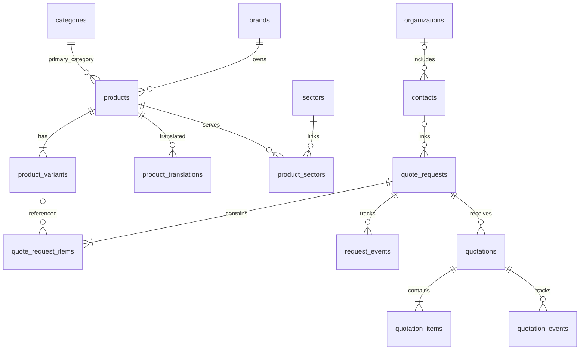

# وثيقة متطلبات المنتج — M.A.S Engineering For Trade

الإصدار: 1.0 — 16 نوفمبر 2026 (توقيت القاهرة). الحالة: مسودة متكاملة للمراجعة قبل التنفيذ.

هذه الوثيقة تحدد السلوك المطلوب للمنتج وتصميم البيانات المنطقي ومعايير القبول. لا تعني أن الوظائف المذكورة منفذة. تفاصيل SQL النهائية تُراجع في مرحلة التصميم وتُحفظ في migrations.

## 1. القرارات المعتمدة وحدود الوثيقة

| البند | القرار | المصدر |
|---|---|---|
| نموذج العمل | كتالوج منتجات وطلبات عروض أسعار B2B، مع إتاحة الاستفسار للأفراد | تأكيد صاحب المشروع |
| الشراء الإلكتروني | خارج النسخة الأولى: لا دفع أو checkout أو طلبات شراء أو شحن آلي | تأكيد صاحب المشروع |
| قاعدة البيانات | Supabase PostgreSQL | تأكيد صاحب المشروع |
| اللغة | عربي وإنجليزي؛ العربية الافتراضية وRTL | موجود حاليًا؛ الاستمرار مقترح |
| الواجهة | تطوير مشروع Next.js الحالي | مقترح مبني على المستودع |
| استضافة الواجهة والـAPI | Vercel، مع Supabase للخدمات الدائمة | اتجاه المشروع السابق؛ يلزم ربط الحساب عند النشر |
| حسابات العملاء | لا تسجيل دخول للعملاء في V1؛ حسابات داخلية للموظفين | مقترح |
| الأسعار | لا أسعار عامة في V1؛ الأسعار داخل عروض المبيعات فقط | مقترح |
| المخزون | حالة توفر يدوية، دون أرصدة أو حجز كميات | مقترح |

كل قرار غير معتمد صراحة في الجدول هو افتراض تصميم قابل للمراجعة، ولا يوقف إعداد الوثيقة.

## 2. الوضع الحالي والفجوة

تمت مراجعة `app/page.tsx` و`app/layout.tsx` و`lib/site.ts` و`lib/i18n.ts` ومكونات المنتجات والتواصل والنموذج.

- الصفحة العامة الوحيدة هي `/`، وبها أقسام: Hero، العلامات، نبذة، المنتجات، الشركاء، القطاعات، التواصل، Footer، وزر واتساب ثابت.
- روابط التنقل الحالية anchors داخل الصفحة؛ لا توجد صفحات كتالوج أو تفاصيل منتج أو لوحة إدارة أو API خاص بالتطبيق.
- المعروض حاليًا مجموعات الزيوت والشحوم ورمان البلي؛ لا توجد منتجات فردية أو SKU أو عبوات مسجلة.
- العلامات والهواتف والعناوين والمحتوى العربي والإنجليزي مكتوبة داخل الكود.
- النموذج الحالي يجمع الاسم والشركة والموبايل والمجموعة والعلامة والكمية كنص والملاحظات؛ يتحقق داخل المتصفح ثم يفتح واتساب. لا يحفظ طلبًا ولا يثبت إرسال الرسالة.
- تبديل اللغة حاليًا يعتمد على cookie باسم `mas-lang` وتغيير الاتجاه، وليس URLs مستقلة لكل لغة.
- لا يوجد تكامل Supabase أو حسابات موظفين أو تخزين ملفات أو إدارة طلبات في النسخة الحالية.
- توجد نقطة محتوى تحتاج تصحيحًا أثناء التنفيذ: نص خطأ اختيار المنتج بالعربية يحتوي أحرفًا تالفة في `lib/i18n.ts`.

## 3. الأهداف ومقاييس النجاح

1. تمكين الزائر من الوصول إلى منتج مناسب بالاسم أو الكود أو المواصفة الفنية.
2. تحويل الاستفسارات إلى طلبات موثقة يمكن إسنادها ومتابعتها، دون الاعتماد على فتح واتساب وحده.
3. تمكين الفريق من إدارة الكتالوج والمحتوى دون تعديل الكود.
4. عرض مواصفات وملفات فنية موثوقة باللغتين، وعدم اختلاق اعتماد أو توافق فني.
5. حماية معلومات التواصل والأسعار الداخلية وسجل المبيعات.

| المؤشر | التعريف | هدف أولي مقترح |
|---|---|---|
| نجاح حفظ الطلبات | الطلبات المقبولة والمحفوظة ÷ محاولات صحيحة وصلت للخادم | ≥ 99% شهريًا |
| زمن أول تواصل | من إنشاء الطلب إلى أول نشاط تواصل مسجل | ≤ يوم عمل؛ يُعتمد جدول العمل |
| اكتمال المنتجات المنشورة | منتجات تستوفي شروط النشر ÷ المنتجات المنشورة | 100% |
| التحويل إلى RFQ | الطلبات المحفوظة ÷ جلسات الكتالوج | قياس خط أساس أول 30 يومًا ثم تحديد الهدف |
| البحث بلا نتائج | عمليات البحث بلا نتائج ÷ إجمالي البحث | قياس لتحسين المحتوى والمرادفات |

تُستبعد الطلبات التجريبية والمزعجة من تقارير الأعمال، وتُقاس أخطاء الشبكة منفصلة. فتح واتساب أو الضغط على زر لا يُحتسب طلبًا محفوظًا أو رسالة مستلمة.

## 4. نطاق الإطلاق والأولويات

**P0 — لازم للإطلاق:** كتالوج وتصنيفات وعلامات وقطاعات وصفحات تفاصيل، بحث وفلاتر، سلة طلب عرض سعر، حفظ RFQ عام ومتعدد البنود، نموذج تواصل عام، لوحة إدارة وصلاحيات، مواصفات ومتغيرات منتجات، مكتبة ملفات، محتوى عربي/إنجليزي، متابعة العملاء والطلبات، تحرير وإصدار عرض سعر PDF داخلي، سجل تدقيق، SEO، حماية ونسخ احتياطي ومراقبة.

**P1 — بعد استقرار الإطلاق:** استيراد CSV للمنتجات مع معاينة أخطاء، إشعارات بريد تلقائية وتذكير بالمتابعة، بحث تقريبي متقدم، مقارنة منتجات، تقارير موسعة، إحصاءات تنزيل المستندات.

**مؤجل ويحتاج PRD منفصل:** حسابات العملاء، بوابة متابعة عامة للطلب، موافقة العميل إلكترونيًا، دفع وفواتير ضريبية، أوامر توريد وشحن، مخزون كمي ومستودعات وحجز، ربط ERP/CRM، WhatsApp Business API، أسعار تعاقدية، توصية بدائل فنية آلية، لغات إضافية.

الإطلاق لا يعتمد على البريد أو WhatsApp API؛ الطلب يُحفظ أولًا ويظهر في صندوق وارد الإدارة. لا تُعرض رسائل توحي بإرسال إشعار آلي لم يتم تنفيذه.

## 5. المستخدمون والصلاحيات

| الدور | الصلاحيات |
|---|---|
| زائر | قراءة المنشور، البحث، تنزيل الملفات العامة، تجهيز وإرسال RFQ، إرسال استفسار |
| مسؤول النظام Owner | كل الإدارة، دعوة الموظفين وتعطيلهم، الأدوار، الإعدادات الحساسة، التصدير والتدقيق |
| مدير الكتالوج Catalog Manager | المنتجات والمتغيرات والتصنيفات والعلامات والقطاعات والوسائط، اعتماد ونشر محتوى الكتالوج |
| محرر المحتوى Content Editor | محتوى الصفحات وصور العرض والفروع وSEO؛ لا بيانات عملاء أو أسعار داخلية أو تعديل صلاحيات |
| مسؤول المبيعات Sales Manager | جميع الطلبات والعملاء، الإسناد، إصدار العروض، التقارير والتصدير المرتبط بالمبيعات |
| موظف المبيعات Sales Agent | الطلبات المسندة إليه فقط، العملاء المرتبطون بها، الملاحظات والعروض الخاصة بها؛ لا إسناد ذاتي لطلبات أخرى |

يمكن للموظف حمل أكثر من دور. المنع هو الافتراضي، والصلاحية تُتحقق في الخادم وRLS، وليس بإخفاء الزر فقط. تعطيل الموظف يسحب وصوله حتى لو لديه جلسة قائمة. لا تسجيل ذاتي للموظفين.

## 6. خريطة الصفحات العامة

المسارات المقترحة تستخدم `/ar` و`/en`؛ مثال: `/ar/products`. يكون `/` تحويلًا ثابتًا إلى `/ar`؛ cookie يُستخدم لتفضيل التبديل ولا يغير محتوى URL مفهرس. لا تعارض بين اللغة في HTML وURL.

| المعرّف | المسار بعد `/{locale}` | المحتوى والوظائف المطلوبة |
|---|---|---|
| PUB-01 | `/` | الرئيسية: شرائح Hero، مجموعات المنتجات، منتجات مميزة، العلامات، النبذة، القطاعات، CTA وعناوين التواصل |
| PUB-02 | `/products` | الكتالوج الكامل: بحث وفلاتر وترتيب وترقيم صفحات وبطاقات منتجات |
| PUB-03 | `/categories/[slug]` | تعريف التصنيف وصورته وتصنيفاته الفرعية وقائمة منتجاته؛ يدعم فلترة الفروع |
| PUB-04 | `/products/[slug]` | صفحة المنتج الفنية والتجارية كاملة، وفق القسم 8 |
| PUB-05 | `/brands` | قائمة العلامات المنشورة؛ بحث بالاسم ونوع المنتجات |
| PUB-06 | `/brands/[slug]` | شعار ووصف العلامة وموقعها الرسمي ومنتجاتها؛ صفة موزع معتمد لا تظهر دون محتوى معتمد |
| PUB-07 | `/sectors` | القطاعات الستة الحالية وأي قطاعات تنشرها الإدارة |
| PUB-08 | `/sectors/[slug]` | وصف احتياج القطاع ومنتجات مرتبطة يدويًا وCTA للدعم الفني |
| PUB-09 | `/about` | نبذة، نقاط القوة، مجالات التوريد، فروع ومخازن موثقة؛ دون أرقام تسويقية مختلقة |
| PUB-10 | `/contact` | الهواتف وواتساب والبريد والعناوين وساعات العمل ونموذج تواصل عام |
| PUB-11 | `/request-quote` | مراجعة بنود RFQ وإضافة بند حر ونموذج بيانات العميل والإرسال |
| PUB-12 | `/request-quote/success` | تأكيد الحفظ ورقم مرجعي من نتيجة الجلسة نفسها؛ دون كشف البيانات عبر query string |
| PUB-13 | `/privacy` | سياسة جمع البيانات والغرض والاحتفاظ والجهات ووسيلة طلب الحذف |
| PUB-14 | `/terms` | شروط استخدام الكتالوج وعروض الأسعار وعدم اعتبار التوفر أو الطلب تأكيد توريد |
| PUB-15 | 404 / خطأ / صيانة | صفحات عربية وإنجليزية وروابط رجوع ومعرّف دعم آمن عند الخطأ |

الحالات العامة لكل صفحة ديناميكية: تحميل، محتوى صحيح، نتيجة فارغة، خطأ قابل لإعادة المحاولة، ومحتوى غير موجود. عطل Supabase يرجع خطأ خدمة مناسبًا، ولا يُعرض على أنه «منتج غير موجود» أو قائمة فارغة.

الهيدر والفوتر يعملان من كل صفحة دون anchors مكسورة. مفتاح اللغة ينتقل لنظير الصفحة ويحافظ على الفلاتر الممكنة، وإلا يعرض رسالة انتقال للكتالوج بنفس اللغة. فروع الشركة الحالية تُنقل بعد مراجعة صحتها.

## 7. الكتالوج والبحث والتصفية

### CAT-01: التصنيفات وبطاقة المنتج

- تصنيفات هرمية: مجموعات رئيسية oils وgrease وbearings، ثم فروع. يمنع الدوران داخل شجرة التصنيف.
- المنتج له تصنيف أساسي واحد وعدة تصنيفات إضافية اختيارية، وعلامة واحدة، وقطاعات متعددة.
- البطاقة: الصورة، الاسم حسب اللغة، العلامة، كود الموديل إن وجد، أهم 2–3 مواصفات، عدد المتغيرات وحالة التوفر العامة، «التفاصيل» و«أضف لطلب السعر».
- لا يُعرض سعر أو كمية مخزون. حالة «متاح» لا تعني حجزًا أو ضمان توريد.
- إذا احتاج المنتج اختيار متغير، يفتح الزر اختيار المتغير أولًا؛ لا يختار عبوة افتراضية بصورة صامتة.

### CAT-02: البحث

- بحث بالاسم العربي والإنجليزي، SKU، model/part number، مرادفات معتمدة، والعلامة.
- أولوية التطابق: SKU/part number التام، ثم بداية الكود، ثم الاسم والمرادفات والوصف.
- دعم الأرقام العربية واللاتينية، إزالة التشكيل والتطويل وتسوية صور الألف لأغراض البحث فقط، مع الاحتفاظ بالاسم الأصلي.
- SKU يحتفظ بالشرطات واللاحقات المميزة فنيًا؛ المقارنة الإضافية المسوّاة لا تستبدل القيمة الأصلية ولا تخلط الموديلات.
- الحد الأقصى للاستعلام 100 حرف، الطلب الفارغ يعرض الكتالوج، وإدخال HTML يعامل كنص.
- بحث P0 باستخدام فهارس PostgreSQL وحقول بحث مسوّاة و`pg_trgm` إن توفر؛ لا اعتماد على stemming عربي جاهز دون اختبار.

### CAT-03: الفلاتر والترتيب

- فلاتر عامة: التصنيف، العلامة، القطاع، التوفر. فلاتر فنية حسب المجموعة: اللزوجة/السعة، NLGI، الأبعاد ونوع الرمان…
- OR داخل قيم الفلتر نفسه، وAND بين الفلاتر المختلفة؛ مواصفات المتغير يجب أن تتحقق في نفس المتغير لتجنب تطابق مضلل.
- قيم الفلاتر وأعدادها تخص المنتجات المنشورة ضمن النطاق الحالي؛ المنتج ذو عدة متغيرات يُحسب مرة واحدة.
- URL يحفظ `q, category, brand, sector, availability, attr.*, sort, page, pageSize`؛ الروابط قابلة للمشاركة، وتغيير الفلتر يعيد الصفحة إلى 1.
- الافتراضي: المميز ثم الأحدث ثم ID لضمان ترتيب ثابت؛ بدائل: الاسم والأحدث؛ لا ترتيب بالسعر.
- حجم الصفحة الافتراضي 24، والمسموح 12/24/48، وحد API الأقصى 48. لا تكرار لمنتج بسبب joins.
- حالة بلا نتائج: حذف الفلاتر أو طلب منتج غير مدرج، دون اقتراح مواصفات بديلة على أنها متوافقة.

## 8. صفحة تفاصيل المنتج

### PDP-01: ترتيب ومكونات الصفحة

1. Breadcrumb: الرئيسية ← التصنيف ← المنتج.
2. معرض صور قابل للتكبير، نص بديل عربي/إنجليزي، وصورة بديلة عند غياب صورة إضافية.
3. الاسم، العلامة ورابطها، وصف مختصر، model/part number، حالة التوفر، وعبارة «السعر حسب الكمية والمواصفات».
4. محدد المتغيرات: عبوة/سعة أو موديل/مقاس؛ يغير SKU والمواصفات والصورة والتوفر ووحدة الطلب.
5. كمية موجبة ووحدة بيع محددة، «أضف إلى طلب عرض السعر»، واتصال/واتساب للاستفسار.
6. وصف فني، استخدامات، جدول مواصفات، خصائص وفوائد، وملفات فنية عامة TDS/SDS أو كتالوج الشركة المصنعة.
7. تنبيه أن ملاءمة المنتج تعتمد على مواصفات المعدة وأن الاعتماد الفني يحتاج تأكيدًا.
8. منتجات مرتبطة يدويًا، أو منتجات من نفس التصنيف عند غياب الاختيار؛ لا تسمى بدائل مكافئة دون اعتماد مهندس.

### PDP-02: البيانات الإلزامية للنشر

| المستوى | المطلوب |
|---|---|
| المنتج | معرف، اسم عربي وإنجليزي، slug، علامة فعالة، تصنيف منشور، وصف مختصر باللغتين، حالة النشر، صورة رئيسية بنص بديل باللغتين |
| المتغير | SKU فريد، عنوان عرض باللغتين، وحدة بيع، حالة توفر، الحد الأدنى للطلب وخطوة الكمية، فعال، المواصفات المطلوبة حسب قالب التصنيف |
| التفاصيل | وصف تفصيلي باللغتين؛ لا نشر لوصف تجريبي أو مواصفات غير موثقة |
| SEO | عنوان ووصف مولدان من المحتوى كافيان؛ overrides اختيارية وصورة مشاركة افتراضية معتمدة |

كل منتج قابل للطلب يمتلك متغيرًا فعالًا واحدًا على الأقل، حتى إذا كان متغيرًا واحدًا فقط. الملفات الفنية اختيارية؛ لا يظهر زر تنزيل إذا لم يوجد ملف معتمد. SKU داخلي يُولد عند عدم وجود SKU من المورد، بينما part number الخاص بالمصنع حقل منفصل.

### PDP-03: مواصفات المجموعات

| المجموعة | أمثلة مواصفات على المنتج أو المتغير | وحدات/قيم |
|---|---|---|
| زيوت | الاستخدام، أساس الزيت، SAE أو ISO VG حسب النوع، API/ACEA إن كانت موثقة، حجم العبوة، اعتمادات المصنع | لتر أو كجم للعبوة؛ SAE وISO VG أكواد وليسا قياسًا قابلًا للتحويل |
| شحوم | NLGI، نوع المثخن، EP، مجال حرارة التشغيل، مقاومة الماء، وزن العبوة | NLGI قائمة معتمدة، °C، كجم |
| رمان بلي | النوع، part number، d القطر الداخلي، D الخارجي، B العرض، الخلوص، نوع الغلق، الأحمال والسرعة إن توفرت | الأبعاد mm، الأحمال kN، السرعة rpm |

يُنشأ قالب مواصفات لكل تصنيف فرعي؛ مثال زيت هيدروليك يطلب ISO VG، وزيت محركات يطلب SAE إذا انطبق. لا يُفرض حقل غير ملائم على كل المنتجات. القيم المجهولة تبقى فارغة وتعرض «غير متوفر» عند الحاجة، ولا تُسجل صفرًا. القيم الفنية تُنقل من مصدر موثق مع خانة مصدر ومراجِع داخلية.

### PDP-04: حالات المنتج

- draft → published → archived، مع إمكانية إلغاء النشر للعودة إلى draft.
- النشر يتطلب اكتمال اللغتين والمراجع والعلاقات والمواصفات المطلوبة ومتغير فعال. تغيير تصنيف يعيد فحص القالب قبل الحفظ/النشر.
- draft لا يظهر للعامة أو البحث أو sitemap؛ preview للموظف المخول فقط ومن دون cache عام.
- المنتج المؤرشف له صفحة 410 ورسالة بدائل عامة؛ غير الموجود أو draft يرجع 404 للعامة.
- تغيير slug ينشئ تحويل 301؛ لا إعادة استخدام slug مؤرشف لمسار منتج آخر دون قرار صريح.
- عدم التوفر لا يخفي المنتج: يسمح بالاستفسار مع تنبيه؛ لا يؤكد موعد توريد تلقائيًا.

## 9. رحلة طلب عرض السعر RFQ

### RFQ-01: تجهيز البنود

- يمكن الإضافة من الكتالوج أو التفاصيل، أو بدء طلب حر لمنتج غير معروف/غير مدرج.
- قائمة محلية للمتصفح، لا تحتاج حسابًا، وتحفظ معرف المتغير والكمية والوحدة فقط؛ لا تحفظ بيانات التواصل في localStorage.
- دمج المتغير نفسه والوحدة نفسها في بند واحد؛ تعديل الكمية/الملاحظة والحذف ممكن. الحد الأقصى 30 بندًا.
- الكمية موجبة، حتى 3 منازل عشرية، وتلتزم بحد أدنى وخطوة كمية المتغير؛ «قطعة/عبوة» كميات صحيحة حسب إعداد الوحدة.
- بند الكتالوج يحدد variant ووحدة بيعه؛ حجم العبوة صفة مستقلة: 20 لترًا للعبوة × 5 عبوات، وليس تحويل الطلب إلى 100 عبوة.
- البند الحر يتطلب وصفًا 3–500 حرف وكمية ووحدة، وتصنيفًا أو «غير محدد»، والعلامة المطلوبة اختيارية.

### RFQ-02: بيانات العميل

| الحقل | القاعدة |
|---|---|
| الاسم | مطلوب 2–120 حرف |
| الموبايل | مطلوب؛ تحويل الأرقام العربية؛ تطبيع إلى E.164 مع مصر كافتراضي قابل للتغيير؛ تحقق بالخادم |
| اسم الشركة | اختياري حتى 160 حرف |
| البريد | اختياري؛ صيغة صحيحة حتى 254 حرف |
| المدينة/المحافظة | اختياريان؛ لا عنوان تسليم كامل مطلوب في V1 |
| طريقة التواصل | هاتف أو واتساب أو بريد؛ البريد مطلوب إذا اختير البريد |
| الملاحظات | اختيارية حتى 2000 حرف |
| موافقة الخصوصية | مطلوبة بإصدار السياسة ووقت الموافقة؛ لا موافقة تسويقية إجبارية |
| المصدر | صفحة/لغة وإحالة وحملة UTM مسموحة ومحدودة؛ لا أسرار أو بيانات شخصية في URL |

مرفقات الزائر مؤجلة؛ يكتب المواصفات في الملاحظات ويمكن للفريق طلب المستندات عبر قناة معتمدة لاحقًا. هذا يمنع إدخال دورة رفع عامة غير مؤمنة ضمن V1.

### RFQ-03: الحفظ والتأكيد

1. المتصفح يتحقق لسرعة الاستخدام؛ الخادم يعيد كامل التحقق ويطبق rate limit وحماية الإساءة.
2. الخادم يعيد جلب المنتجات والمتغيرات والوحدات؛ لا يثق بالاسم أو المواصفات أو الأسعار المرسلة من المتصفح.
3. تحفظ transaction واحدة الطلب والبنود ولقطة البيانات والموافقة والمصدر؛ إما جميعها أو لا شيء.
4. `Idempotency-Key` مع hash للطلب يمنع تكرار الضغط: نفس المفتاح والمحتوى يرجع نفس النتيجة، وتغيير المحتوى بنفس المفتاح يرجع 409. يحتفظ بالمفتاح 24 ساعة على الأقل.
5. بعد commit فقط تظهر رسالة «تم استلام طلبك» ورقم مرجعي فريد، ثم يُفرّغ نموذج التواصل والسلة.
6. يُتاح فتح واتساب برسالة عامة ورقم الطلب؛ لا يُفتح تلقائيًا قبل الحفظ ولا تُدرج بيانات حساسة في الرابط.
7. إذا أغلق المستخدم واتساب، يبقى الطلب محفوظًا. إذا فشل الحفظ، تبقى السلة ويظهر retry؛ يمكن عرض تواصل مباشر بصياغة «لم يُحفظ الطلب».
8. الطلب العام لا يتيح lookup بالرقم المرجعي أو الموبايل. تحديث الصفحة يعرض تأكيدًا عامًا إن ضاعت نتيجة الجلسة؛ لا endpoint مكشوف لاسترجاع PII.

إذا حُذف/أوقف متغير منذ إضافته للسلة، يرجع خطأ محدد للبند مع إبقاء بقية البنود؛ لا يستبدله النظام تلقائيًا. تعطيل المنتج بعد استلام الطلب لا يغير لقطة الطلب التاريخية.

### RFQ-04: متابعة المبيعات

الحالات المقترحة: `new → assigned → in_progress → awaiting_customer → quoted → won / lost / cancelled`.

| الانتقال | المسموح والشرط |
|---|---|
| new → assigned | مدير المبيعات يحدد موظفًا فعالًا |
| assigned → in_progress | الموظف المسند أو المدير يبدأ المتابعة |
| in_progress ↔ awaiting_customer | إضافة سبب/المعلومة المطلوبة |
| in_progress أو awaiting_customer → quoted | وجود إصدار عرض سعر صادر ومسجل التسليم، وليس مجرد مسودة |
| quoted → in_progress | تفاوض أو مراجعة؛ لا تعديل النسخة الصادرة السابقة |
| quoted → won | تسجيل موافقة تجارية خارجية وملاحظة الدليل؛ ليست دفعة أو أمر بيع إلكتروني |
| أي حالة مفتوحة → lost أو cancelled | سبب إغلاق مطلوب |
| حالة مغلقة → in_progress | مدير المبيعات فقط مع سبب إعادة الفتح |

كل انتقال يسجل المنفذ والوقت والحالة السابقة/التالية والسبب. الإسناد/إعادة الإسناد نشاط منفصل، ولا يعيد الحالة تلقائيًا. يمنع تجاوز دورة الحالات من API مباشرة.

يتضمن الطلب: مسؤول المتابعة، أولوية، موعد متابعة تالٍ، ملاحظات داخلية، سجل اتصالات يدوي، عروضه، وتاريخ كامل. إشعارات P0 داخل صندوق الوارد ولوحة العدادات؛ الإشعارات الخارجية P1.

### RFQ-05: إعداد عرض مبيعات

- الموظف يبدأ مسودة من الطلب مع نسخ البنود، ويحدد السعر والوحدة والكمية والعملة ومدة الصلاحية والمهلة المتوقعة والشروط.
- العملة الافتراضية EGP وقابلة للضبط. كل عرض بعملة واحدة، والأسعار `numeric` دون float.
- خصم على مستوى البند فقط في V1. مجموع البند = كمية × سعر وحدة − خصم؛ الضريبة المحسوبة على صافي البند وفق نسبة محددة لكل بند. التقريب نصف لأعلى إلى منزلتين لكل صافي/ضريبة بند، والإجمالي جمع القيم المقربة. خصم لا يتجاوز الإجمالي الخام ولا قيم سالبة.
- نسب الضريبة وشروطها تُراجع مع الشركة؛ لا تُفترض نسبة قانونية ثابتة. يعرض الملف بوضوح ما إذا كانت الضريبة محسوبة، ولا يسمى فاتورة ضريبية.
- لا إصدار إذا غابت الأسعار أو الشروط الإلزامية أو انتهت الصلاحية. الإصدار يثبت لقطة الشركة والعميل والبنود والمبالغ والشروط.
- يُولد PDF عربي/إنجليزي وفق لغة العرض مع اختبار الخطوط وRTL. الملف خاص؛ تنزيل الموظف عبر signed URL قصيرة الصلاحية.
- النسخة الصادرة غير قابلة للتعديل؛ التعديل ينشئ revision جديدًا، مع رقم فريد مثل `MAS-Q-2026-000123-R2` وربط النسخة السابقة. الأرقام تُولد بالمعاملة/sequence ولا تستخدم MAX+1.
- حالات العرض: draft، issued، sent، accepted، rejected، expired، superseded. قبول/رفض العميل يسجل يدويًا بواسطة موظف مخول مع مصدر ووقت، ولا يتيح شراء إلكترونيًا.
- الموظف ينزل ويرسل الملف عبر قناته المعتمدة ثم يسجل `sent` والقناة والوقت؛ مجرد إنشاء PDF لا يعني الإرسال. انتهت الصلاحية تمنع قبولًا جديدًا إلا بإصدار جديد.

## 10. التواصل والمحتوى والملفات

**CON-01:** نموذج `/contact` يحفظ استفسارًا مستقلًا: اسم وموبايل ورسالة مطلوبة، بريد وشركة اختياريان، لغة وموافقة ومصدر. حالات new / assigned / in_progress / resolved / spam. إسناد وصلاحيات مماثلة للـRFQ. تحويله إلى RFQ ينشئ ارتباطًا فريدًا بعد استكمال بند واحد على الأقل؛ لا يختلق بندًا، ولا ينشئ طلبين بإعادة الضغط.

**CMS-01:** إدارة شرائح الرئيسية وترتيبها وCTA آمن، نبذة ومزايا الشركة، العلامات المميزة، المنتجات المميزة، القطاعات، الفروع ووسائل التواصل، صفحات الخصوصية والشروط، SEO والروابط الاجتماعية. لا حقل HTML/JavaScript حر غير منقح. نطاق CMS محدد لهذه المكونات وليس منشئ صفحات غير محدود.

**MED-01:** صور JPG/PNG/WebP حتى 5MB، وملفات PDF حتى 20MB؛ حدود قابلة للمراجعة. فحص MIME وتوقيع الملف والحجم وإزالة metadata الحساسة من الصور؛ منع SVG/HTML والملفات التنفيذية في V1. الرفع للموظف المخول فقط، بمسارات عشوائية واسم ملف أصلي للعرض لا للمسار.

الملف يمر pending → ready أو rejected، مع تحقق/فحص برمجية خبيثة للـPDF قبل النشر. لا يتم تنزيل ملفات pending للعامة. الملفات الداخلية لا تنتقل إلى bucket عام. يمنع حذف ملف مستخدم؛ تُعرض مواضع الاستخدام ويُستبدل أولًا. السجل المؤرشف لا يُفقد الملف التاريخي لعرض سعر.

**LOC-01:** المحتوى التجاري له ترجمة عربية وإنجليزية. يجوز حفظ مسودة ناقصة، ويمنع النشر حتى اكتمالهما. الأكواد والأرقام الفنية لا تترجم. مترجم الواجهة ثابت داخل الكود؛ بيانات المنتجات والمحتوى التجاري من قاعدة البيانات.

## 11. صفحات لوحة الإدارة

لوحة الإدارة تحت `/admin`، عربية افتراضيًا مع دعم الإنجليزية؛ غير مفهرسة ومحمية. كل جدول يدعم البحث والفلاتر والترقيم، وتبقى الفلاتر في URL دون PII.

| المعرّف | المسار | الوظائف والحالات الرئيسية |
|---|---|---|
| ADM-01 | `/admin/login` | دخول Supabase Auth، استعادة كلمة المرور، MFA حسب الدور، رسائل لا تكشف وجود حساب |
| ADM-02 | `/admin` | طلبات جديدة، متأخرة، المسندة للموظف، منتجات ناقصة، ملخص فترة؛ الأرقام حسب الصلاحية |
| ADM-03 | `/admin/products` | بحث بالاسم والكود، فلتر الحالة/الفئة/العلامة، إضافة وتعديل ونشر/أرشفة؛ حذف draft غير مرتبط فقط |
| ADM-04 | `/admin/products/new` و`/[id]` | تبويبات: أساسي، ترجمات، وصف، مواصفات، متغيرات، صور، مستندات، قطاعات، مرتبطة، SEO، سجل تغييرات ومعاينة |
| ADM-05 | `/admin/categories` | شجرة التصنيفات، الترتيب، قالب الخصائص، الترجمات؛ منع حذف تصنيف مرتبط أو دورات |
| ADM-06 | `/admin/attributes` | تعريف خصائص ووحدات وخيارات وترتيب وفلاتر وحقول مطلوبة حسب التصنيف |
| ADM-07 | `/admin/brands` و`/[id]` | الشعار والنبذة وروابطها وترتيبها وترجماتها وحالة النشر |
| ADM-08 | `/admin/sectors` و`/[id]` | المحتوى والصور والمنتجات المرتبطة وترتيب الظهور |
| ADM-09 | `/admin/media` | رفع ومعاينة وحالة الفحص وalt والاستخدامات والأرشفة |
| ADM-10 | `/admin/quote-requests` | صندوق الطلبات، فلاتر الحالة والمسؤول والمصدر والتاريخ والأولوية، تصدير مخول |
| ADM-11 | `/admin/quote-requests/[id]` | بيانات العميل والبنود ولقطات المواصفات والإسناد والحالات والملاحظات والمتابعة والعروض |
| ADM-12 | `/admin/quotations/[id]` | تحرير المسودة والحسابات ومعاينة PDF والإصدار والمراجعات والتسليم اليدوي |
| ADM-13 | `/admin/customers` و`/[id]` | جهات اتصال وشركات وتاريخ RFQ والعروض، كشف تشابه واقتراح ربط يدوي |
| ADM-14 | `/admin/inquiries` و`/[id]` | الرسائل والتصنيف والإسناد والرد المسجل والتحويل إلى طلب |
| ADM-15 | `/admin/content` | الرئيسية والنبذة والشرائح والصفحات القانونية والترجمات وSEO؛ حالة draft/published |
| ADM-16 | `/admin/settings` | اسم الشركة وأرقام الاتصال والفروع ووحدات البيع والقيم الافتراضية؛ إعدادات تكامل للخادم فقط |
| ADM-17 | `/admin/team` | دعوة وتعطيل المستخدمين وتعيين الأدوار؛ Owner فقط |
| ADM-18 | `/admin/audit-log` | بحث أحداث حساسة بدون كلمات مرور/توكنات/تفاصيل PII غير لازمة |
| ADM-19 | `/admin/reports` | معدل الطلبات والمصادر والحالات وأداء المتابعة؛ بيانات التجارب/spam مستبعدة |

الحفظ المتزامن يستخدم `version` أو `updated_at` لمنع فقد تعديل موظف آخر؛ يرجع 409 مع طلب إعادة تحميل. الأعمال الحساسة مثل الأرشفة والنشر والتعطيل والإصدار تطلب تأكيد فعل واضح، وتسجل في التدقيق.

## 12. بنية Supabase المقترحة

- **PostgreSQL:** مصدر الحقيقة للكتالوج والمحتوى والطلبات والعروض والصلاحيات.
- **Supabase Auth:** للموظفين فقط مع دعوات، جلسات آمنة، واسترجاع الحساب؛ إنشاء أول Owner بإجراء تشغيلي مضبوط، دون endpoint عام لترقية الأدوار.
- **Supabase Storage:** buckets منفصلة: `catalog-public` لصور وPDFs عامة معتمدة، `catalog-staging` خاص للرفع والفحص، `sales-private` لعروض الأسعار. لا يوضع ملف مبيعات في public.
- **Next.js Route Handlers/Server Actions:** حدود التحقق والأعمال، وتتعامل مع Supabase. عمليات الموظف تمر بجلسة المستخدم لتطبيق RLS، والعمليات العامة الكتابية تمر فقط بالخادم.
- **RPC/DB functions:** عمليات حفظ RFQ والإصدار وانتقالات الحالة تحتاج معاملات ذرية. تُقيد صلاحيات التنفيذ، ويثبت `search_path` لأي `security definer` مع فحص الدور والمدخلات.
- لا اتصال مباشر من متصفح مجهول بجداول العملاء أو الطلبات. القراءة العامة عبر واجهات API/إسقاطات read-only للمنشور فقط؛ تحديد الأعمدة صراحة وعدم استخدام `select *`.
- استخدام Supabase Data API/RPC يقلل اتصالات PostgreSQL في Vercel. إن احتاجت أداة اتصالًا مباشرًا تستخدم pooler المناسب؛ migrations عبر اتصال معتمد منفصل.
- Realtime اختياري وليس شرط إطلاق؛ polling محدود أو refresh يكفي للصندوق. لا اعتماد على ذاكرة Function أو قرص Vercel للاحتفاظ بالملفات أو الوظائف الطويلة.
- PDF والفحص والمهام الطويلة عبر وظيفة محدودة الموارد أو worker دائم/queue؛ تسجل jobs في PostgreSQL وتُشغل بجدولة موثقة. لا أعمال خلفية بعد انتهاء response دون ضمان تنفيذ.

### 12.1 مفاتيح وإعدادات

| المتغير | أين يستخدم | النوع |
|---|---|---|
| `NEXT_PUBLIC_SUPABASE_URL` | المشروع العام والمتصفح عند الحاجة لـAuth | عام |
| `NEXT_PUBLIC_SUPABASE_PUBLISHABLE_KEY` | Auth أو قراءة مسموحة بـRLS؛ legacy anon بديل إذا المشروع يستخدمه | عام محمي بـRLS |
| `SUPABASE_SECRET_KEY` | عمليات خادم محددة؛ legacy service_role بديل حسب إعداد المشروع | سري جدًا؛ لا NEXT_PUBLIC ولا logs |
| `NEXT_PUBLIC_SITE_URL` | canonical وredirects | عام لكل بيئة |
| `DATABASE_URL` | migrations/tools فقط إذا استُخدم اتصال SQL | سري؛ لا حاجة لإرساله للمتصفح |
| إعداد مزود البريد | دعوات واستعادة حسابات الموظفين في الإنتاج | سري لدى مزود الخدمة/Supabase |
| إعداد challenge ضد spam | عند تفعيل المزود المختار | مفتاح موقع عام وسر تحقق بالخادم |

هذه أسماء مقترحة للتنفيذ وليست طلبًا لإرسال قيمها في المحادثة. تُحفظ الأسرار في إعدادات الاستضافة وتستخدم HTTPS إلى مشروع Supabase. حساب بيئة production منفصل عن staging؛ روابط Auth المسموحة وSMTP إنتاجي موثوق وحدود الخطة متطلبات إطلاق.

## 13. تصميم قاعدة البيانات المنطقي

قاعدة البيانات علائقية وليست حقل JSON واحدًا للكتالوج. المعرفات UUID افتراضيًا، والتواريخ `timestamptz` تحفظ UTC وتعرض بتوقيت `Africa/Cairo`. الجداول القابلة للتعديل لها `created_at`, `updated_at`, `version` ومُنشئ/مُحدّث عند الحاجة. JSONB مخصص للقوالب المقيدة واللقطات التاريخية، وليس بديلًا للعلاقات.

### 13.1 الموظفون والمرجعيات

| الجدول | أهم الحقول والعلاقات والقيود |
|---|---|
| `profiles` | `id` FK إلى `auth.users`, display_name, active؛ بلا password أو token |
| `roles` / `permissions` | أكواد فريدة للأدوار والأذونات المعلومة |
| `user_roles` / `role_permissions` | مفاتيح مركبة تمنع التكرار؛ تعديل Owner فقط |
| `units` | code فريد، name_ar/en، quantity_precision، فعال؛ piece/pack/drum/kg/liter وفق وحدات البيع المعتمدة |
| `locations` | kind: hq/branch/warehouse، address_ar/en، هواتف، map_url اختياري، ساعات عمل منظمة، order، published |
| `site_settings` | مفاتيح محددة مخططيًا أو سجل singleton لبيانات الشركة العامة؛ لا أسرار أو أدوار في JSON عام |

### 13.2 الكتالوج

| الجدول | أهم الحقول والعلاقات والقيود |
|---|---|
| `categories` | parent_id self FK، code وslug فريدان، family: oils/grease/bearings، order، status؛ منع الدورة ونشر فرع لأصل غير منشور |
| `category_translations` | category_id + locale PK، name، intro، description، SEO؛ locale ar/en فقط |
| `brands` / `brand_translations` | slug فريد، status، logo_media_id، featured/order، official_url؛ الاسم والوصف وSEO مترجمة |
| `sectors` / `sector_translations` | slug فريد، status، image_media_id، order، النص وSEO باللغتين |
| `products` | slug فريد، brand_id، primary_category_id، family، model_code، status، featured، main_media_id، published_at، archived_at، internal_source_note |
| `product_translations` | product_id + locale PK، name، short_description، description، applications، benefits، SEO |
| `product_categories` | product_id + category_id unique؛ الأساسي يظل في products ولا يكرر منطقيًا ضمن الإضافي |
| `product_sectors` | product_id + sector_id PK |
| `product_variants` | product_id FK، sku فريد case-insensitive، manufacturer_part_number، unit_id، min_quantity، quantity_step، availability، active، order، pack_quantity وpack_unit_id اختياريان معًا |
| `variant_translations` | variant_id + locale PK، label مثل «عبوة 20 لتر» |
| `attribute_definitions` | code فريد، name_ar/en، type: text/number/boolean/option/multi_option، unit_id اختياري، scope: product/variant، filterable، sortable |
| `attribute_options` | attribute_id + code unique، label_ar/en، order |
| `category_attributes` | category_id + attribute_id PK، required، display_order، min/max عند الانطباق؛ قواعد التوارث واضحة من الجذر للفرع |
| `product_attribute_values` | product_id + attribute_id unique؛ قيمة typed متوافقة مع تعريف الخاصية |
| `variant_attribute_values` | variant_id + attribute_id unique؛ قيمة typed متوافقة مع تعريف الخاصية |
| `product_attribute_options` / `variant_attribute_options` | روابط القيم متعددة الخيارات، PK مركب؛ تمنع option من خاصية أخرى |
| `media_assets` | bucket، object_path فريد، original_name، mime، size، width/height، visibility، scan_status، alt_ar/en، created_by |
| `product_media` | product_id، media_id، kind: image/TDS/SDS/catalog، locale اختياري، order؛ unique للعلاقة |
| `variant_media` | variant_id + media_id unique؛ صور خاصة بالعبوة أو الموديل |
| `related_products` | product_id + related_product_id PK، order، relation: related/verified_alternative؛ منع الذات؛ اعتماد فني للبديل |
| `slug_redirects` | entity_type، old_slug unique ضمن النوع، target_entity_id؛ يمنع الحلقات والتعارض مع slug حالي |

القيمة typed تستخدم عمودًا مناسبًا واحدًا مثل text_value أو number_value أو boolean_value أو option_id. `CHECK` يضمن اختيار نوع واحد، وtrigger/validation يطابقه مع definition. خصائص multi_option تستخدم جدول الربط فقط. لا يُسمح بنص عشوائي بدل وحدة قياس أو خيار مستخدم في الفلاتر. تغيير نوع خاصية مستخدمة يحتاج ترحيل قيم منضبط ولا يتم مباشرة من UI.

حالات availability المقترحة: `available`, `on_request`, `unavailable`. تظهر للعميل «متاح للاستفسار/توريد حسب الطلب/غير متاح حاليًا» وفق الصياغة المعتمدة؛ لا تمثل رصيد مخزون.

### 13.3 المحتوى

| الجدول | أهم الحقول |
|---|---|
| `content_pages` | key/slug فريد، نوع الصفحة، status، published_revision_id |
| `content_revisions` | page_id، revision_number، status، created_by؛ نسخة منشورة ثابتة عند استمرار التحرير |
| `content_blocks` / `content_block_translations` | revision_id، block_type، position، بيانات وفق schema للـHero/نبذة/مزايا/CTA، ونصوص ar/en |
| `navigation_items` | area، label_ar/en، internal_target أو رابط HTTPS آمن، order، active |
| `legal_policy_versions` | policy_type، version فريد ضمن السياسة، content_ar/en، effective_at، published؛ تربط الموافقات بالإصدار |

الـCMS لا يسمح بكتابة إعدادات أمنية أو سكربتات أو SQL. نسخ draft لا تكسر الصفحة المنشورة. نشر نسخة محتوى يبدل المؤشر إلى revision مكتمل ذريًا ثم يعيد التحقق من cache.

### 13.4 العملاء والطلبات

| الجدول | أهم الحقول والعلاقات |
|---|---|
| `organizations` | name، city، governorate، internal_notes محمية |
| `contacts` | organization_id اختياري، name، phone_e164، email اختياري، preferred_channel، active؛ لا إلزام uniqueness للموبايل المشترك |
| `quote_requests` | reference unique، contact_id اختياري، organization_id اختياري، customer_snapshot JSONB، status، assigned_to، priority، follow_up_at، locale، source، source_path، utm مقيدة، notes، is_test، closed_reason، privacy_policy_version_id، consent_at |
| `quote_request_items` | request_id FK، variant_id nullable، category_id/brand_id اختياريان، free_description، quantity numeric(15,3)، unit_id، notes، product_snapshot JSONB؛ XOR بين variant والبند الحر |
| `request_events` | request_id، actor_id، type: status/assignment/contact/note، old/new status، body داخلي، occurred_at؛ append-only |
| `inquiries` | reference unique، بيانات المرسل snapshot، message، assigned_to، status، locale/source/consent، converted_request_id unique nullable |
| `inquiry_events` | inquiry_id، actor_id، type، body، occurred_at؛ إسناد وسجل متابعة |
| `idempotency_records` | operation + key unique، request_hash، safe_response، expires_at؛ خاص بالخادم ولا يحتوي response سريًا للعامة |

حفظ الطلب لا يدمج العملاء تلقائيًا بالهاتف وحده؛ الطلب يحمل snapshot مستقلًا، ثم تربط المبيعات الطلب بجهة اتصال موجودة أو تنشئ جهة بعد المراجعة. السجل القديم لا يتغير بتعديل اسم العميل. لا حذف متسلسل لطلبات التاريخ عند حذف متغير/تعطيل موظف؛ يستخدم RESTRICT أو soft archive حسب العلاقة.

### 13.5 عروض الأسعار والتشغيل

| الجدول | أهم الحقول والعلاقات |
|---|---|
| `quotations` | request_id، number unique، revision، previous_quotation_id، status، currency، valid_until، lead_time_text، customer_snapshot، company_snapshot، terms، locale، subtotal/discount/tax/total، issued_by/at، sent_by/at/channel، pdf_media_id خاص، accepted/rejected_at |
| `quotation_items` | quotation_id، request_item_id nullable، variant_id nullable، snapshot_description وsku، quantity، unit_snapshot، unit_price numeric(18,4)، discount_amount، tax_rate، net_amount/tax_amount/total numeric(18,2)، order |
| `quotation_events` | quotation_id، actor_id، transition/action، timestamp، reason؛ append-only |
| `jobs` | type: pdf/media_scan/notification، entity_id، state: pending/running/succeeded/failed، attempts، next_attempt_at، locked_until، sanitized_error؛ لا payload سري في logs |
| `audit_logs` | actor_id، action، entity_type/id، changed_fields أو قيم منقحة، request_id للتتبع، occurred_at؛ append-only |
| `export_jobs` | requested_by، scope، filters، state، private_file_id، expires_at؛ سياسة صلاحية جديدة عند التنزيل |

جهة المبيعات لا تعدل totals أو status الصادر مباشرة. عمليات الإصدار تحسب الأرقام في الخادم/DB وتنتج لقطة ثابتة؛ إذا فشل PDF يبقى job فاشلًا قابلًا للمحاولة، ولا تسجل عملية إرسال ناجحة. ملف جديد بإعادة التنفيذ يستبدل ناتج الوظيفة نفسه بصورة idempotent دون إصدار عرض إضافي.

### 13.6 العلاقات والفهارس



- فهارس B-tree على كل FK يستخدم في join، وعلى `(status,published_at,id)` للمنتجات، و`(status,assigned_to,created_at)` و`(assigned_to,follow_up_at)` للطلبات.
- فهرس فريد على lower(sku)، وslug والمرجع وأرقام العروض ومفاتيح idempotency؛ unique لكل `(entity_id,locale)`.
- GIN/trigram لحقول البحث المسوّاة، وفهارس `(attribute_id,number_value)` وoption_id للفلاتر؛ لا تفهرس أو تبحث في snapshots التاريخية للكتالوج العام.
- CHECK للكميات والأسعار والحالات والـlocale؛ العلاقات إلزامية حيث نصّت القواعد. الموافقة وقيم source والطول تتحقق في DB والخادم حيث يلزم.
- ملخصات التقارير تُحسب من نفس جداول الحقيقة مع نطاق الصلاحية؛ لا يُكشف إجمالي الشركة لموظف يرى طلباته فقط.

## 14. سياسة RLS وحماية الوصول

| نطاق البيانات | anon | موظف كتالوج/محتوى | مبيعات | Owner / خادم مخول |
|---|---|---|---|---|
| كتالوج منشور وإسقاطات عامة | قراءة حقول عامة فقط | حسب الدور قراءة/تعديل | قراءة | إدارة |
| مسودات وملاحظات المصادر الداخلية | ممنوع | حسب الدور | ممنوع إلا قراءة عامة | إدارة |
| RFQ وبنوده وأحداثه | ممنوع كل العمليات | ممنوع | المسند فقط للموظف؛ الجميع للمدير | إدارة |
| عملاء وجهات اتصال | ممنوع | ممنوع | المرتبط بالطلبات المسموحة؛ تعديل مقيد | إدارة |
| عروض وأسعار وPDFs خاصة | ممنوع | ممنوع | نطاق الطلب نفسه | إدارة |
| استفسارات | ممنوع | ممنوع | وفق الإسناد | إدارة |
| مستخدمون وأدوار وتدقيق | ممنوع | صلاحيات ذاتية محدودة | صلاحيات ذاتية محدودة | Owner فقط للتغيير/التدقيق |

- تفعيل RLS على كل جداول exposed schema. الجداول الداخلية والحساسة في schema غير مكشوف أو بلا grants عامة؛ views العامة تكون `security_invoker` وتستبعد الأعمدة الداخلية.
- سياسة SELECT للمنتج المنشور وحدها لا تخفي أعمدة داخلية؛ يلزم projection أو column grants مع schema منفصل. لا direct read عام لجدول يحتوي بيانات داخلية.
- صلاحيات الموظف تُقرأ من جدول فعال موثوق؛ لا يعتمد النظام على metadata يمكن للمستخدم تعديلها. أي cache للأدوار قصير أو يُلغى فور التعطيل.
- anonymous لا INSERT مباشر إلى طلبات أو عملاء. endpoint عام بالخادم يطبق القواعد ثم ينفذ خدمة محددة؛ مفتاح secret يتجاوز RLS، لذا كل عملية تستخدمه تحتاج authorization صريح.
- Storage policies تمنع القراءة من staging/sales وتمنع الكتابة لغير المخول. public bucket قابل للقراءة بالمسار دائمًا؛ أي ملف حساس لم يُنشر فيه أصلًا.
- لا حذف أو تعديل للسجل التدقيقي أو النسخ الصادرة من الموظفين؛ تُجرى تصحيحات بأحداث/إصدارات جديدة.
- منع التصعيد بتعديل `assigned_to` أو `role` أو status في payload عام؛ allowlist للحقول في كل mutation.

## 15. واجهات الباك إند المقترحة

قاعدة المسارات `/api/v1`؛ العقود النهائية توثق بـOpenAPI قبل توصيل الواجهة. القراءة العامة تعيد المنشور فقط، والنصوص حسب `locale=ar|en`. هيكل القوائم `data + meta(page,pageSize,total,totalPages)`؛ الأخطاء `error(code,message,fieldErrors,requestId)` دون stack أو SQL.

| Method ومسار | الغرض والقواعد |
|---|---|
| `GET /catalog/products` | بحث وفلاتر وترقيم؛ لا snapshots أو أسعار داخلية |
| `GET /catalog/products/:slug` | منتج وترجمات مختارة ومتغيرات ومواصفات وملفات عامة وعلاقات منشورة |
| `GET /catalog/categories` و`/:slug` | شجرة/تفاصيل وصفحة التصنيف |
| `GET /catalog/brands` و`/:slug` | العلامات وتفاصيلها |
| `GET /catalog/sectors` و`/:slug` | القطاعات وتفاصيلها |
| `GET /catalog/facets` | قيم وعدد نتائج الفلاتر بنفس semantics البحث |
| `GET /content/:key` | المحتوى المنشور وبيانات الشركة العامة؛ لا settings حساسة |
| `POST /quote-requests` | RFQ؛ Idempotency-Key مطلوب؛ 201 عند الإنشاء و200 للإعادة المطابقة |
| `POST /inquiries` | حفظ استفسار وموافقة؛ idempotency وحماية إساءة |
| `GET /admin/me` | المستخدم الفعال وأذوناته؛ 401 إذا غير مصادق |
| `GET/POST/PATCH /admin/products...` | إدارة المنتج والمتغيرات بعقود منفصلة؛ version مطلوب للتحديث |
| `POST /admin/products/:id/publish` و`/archive` | فحص قواعد النشر/الأرشفة وتدقيق وإبطال cache |
| `/admin/categories`, `/brands`, `/sectors`, `/attributes`, `/units` | إدارة القواميس والعلاقات حسب الدور؛ منع حذف المرجع المستخدم |
| `POST /admin/media/uploads` و`/:id/finalize` | رفع خاص ثم تحقق وفحص؛ لا نشر قبل ready |
| `GET/PATCH /admin/quote-requests/:id` | قراءة/تعديل حقول مسموحة فقط ضمن الإسناد |
| `POST /admin/quote-requests/:id/assign` و`/transitions` و`/events` | إسناد/تغيير حالة/ملاحظة مع صلاحيات منفصلة |
| `POST /admin/quote-requests/:id/quotations` | إنشاء مسودة عرض |
| `PATCH /admin/quotations/:id` و`/items` | تحرير المسودة فقط |
| `POST /admin/quotations/:id/issue` و`/revise` و`/transitions` | حسابات وإصدار وrevision وإرسال مسجل/قبول/رفض |
| `GET /admin/quotations/:id/download` | تحقق صلاحية ثم signed URL قصيرة؛ لا تخزينه في log |
| `/admin/customers`, `/organizations`, `/inquiries` | عمليات محددة بعقود الأدوار؛ التحويل إلى RFQ endpoint منفصل |
| `/admin/content`, `/locations`, `/settings`, `/team`, `/audit-log`, `/reports`, `/exports` | عقود حسب صفحات الإدارة؛ لا generic mutation عابر للجداول |

الأكواد: 400 صيغة غير صالحة، 401 جلسة غائبة، 403 غير مخول، 404 غير متاح في النطاق، 409 تعارض/idempotency، 422 حقول أو قواعد أعمال، 429 تجاوز حد، 503 تعطل خدمة. لا يمكن التمييز علنًا بين ID خاص غير مسموح وغير موجود.

مثال payload توضيحي لطلب كتالوج (ليس SQL أو عقدًا منفذًا):

```json
{
  "locale": "ar",
  "customer": {"name": "اسم العميل", "phone": "+201000000000", "preferredChannel": "whatsapp"},
  "items": [{"variantId": "UUID", "quantity": 5, "unitCode": "pack", "notes": ""}],
  "privacy": {"accepted": true, "policyVersion": "1.0"},
  "source": {"page": "/ar/products/example", "utmSource": "direct"}
}
```

الاسم والسعر وSKU من المتصفح لا يُستخدمون كمصدر حقيقة. عند الحفظ تضاف snapshot من DB؛ response لا يحتوي PII: `{data: {reference, receivedAt}}` فقط.

## 16. الأمن والخصوصية والتشغيل

- جلسات إدارة آمنة بـcookies مناسبة وHTTPS؛ حماية CSRF/Origin لكل mutation يعتمد على cookie؛ تحديد CORS وعدم فتحه عشوائيًا.
- MFA إلزامي لـOwner ومدير المبيعات ومقترح للباقين؛ عمليات تغيير الأدوار تستلزم إعادة تحقق. دعوات واستعادة الحساب تستخدم redirects مسموحة فقط.
- rate limit موزع في DB/خدمة مشتركة، وليس ذاكرة Vercel: نقطة بداية RFQ خمس محاولات/10 دقائق لكل IP بعد مراعاة proxy، وحد هاتف يومي قابل للضبط، مع مراعاة الشبكات المشتركة. لا يُخزن IP خام بلا ضرورة؛ HMAC بدورة احتفاظ محددة.
- تحدٍ ضد spam عند الاشتباه مع بديل تواصل واضح؛ فشل التحقق لا يعلن نجاحًا. لا يُسمح لـanon بتجاوز endpoint وكتابة الجدول.
- escaping وتنقيح النص الغني، منع XSS وSQL injection، allowlist للروابط، ومنع جلب URLs عشوائية من الخادم لتفادي SSRF.
- logs تشغيلية لا تحتوي الهاتف أو البريد أو body الطلب أو signed URLs أو المفاتيح. الربط بمعرف طلب تقني آمن.
- التصدير CSV محمي ومؤقت وفي نطاق الصلاحية، مع منع CSV formula injection للخلايا التي تبدأ بـ`= + - @` ومعالجة الأسطر. تسجل عملية التنزيل.
- لا توضع بيانات PII في analytics أو tracking URLs أو ملفات عامة. أحداث التحليلات تستخدم product/category IDs وrequest reference آمنًا أو أحداثًا مجمعة.
- مقترح احتفاظ: سجلات rate limit وidempotency أيام لا سنوات؛ ملفات exports 24 ساعة؛ طلبات العمل وبيانات العملاء حتى 24 شهرًا بعد آخر نشاط، ثم حذف/إخفاء هوية وفق سياسة معتمدة. الالتزامات القانونية ومواعيدها تُراجع مع الشركة قبل الإطلاق.
- طلب الحذف يتطلب تحقق هوية وتشغيلًا إداريًا: إزالة PII من contacts وsnapshots وnotes وPDFs/exports ذات الصلة، مع إبقاء الحد التجاري المشروع فقط. النسخ الاحتياطية لها مدة وانتهاء محددان.
- تفعيل backups حسب خطة Supabase الفعلية وتوثيق التكرار والاحتفاظ؛ قاعدة البيانات وStorage يُختبران منفصلين، فلا يُفترض أن DB backup يحفظ الملفات. هدف مبدئي RPO 24 ساعة وRTO يوم عمل، يعتمد بعد اختبار استعادة فعلي.
- مراقبة أخطاء API وفشل jobs وفشل الدخول غير الطبيعي وسعة DB/Storage والاتصالات. فشل إشعار خارجي لا يلغي طلبًا محفوظًا.

## 17. SEO والأداء وإتاحة الاستخدام

- SSR للمحتوى العام، وmetadata وcanonical وhreflang للغتين؛ sitemap للمنشور فقط وrobots يمنع `/admin` وصفحات التأكيد وسلة RFQ.
- URLs الفلاتر والبحث المركبة لا تُفهرس افتراضيًا؛ canonical للكتالوج/التصنيف وفق سياسة واضحة. لا blanket canonical يعطل صفحات المنتجات.
- Product structured data بدون أسعار أو تقييمات أو توفر مخترع؛ Organization وBreadcrumb عند انطباقها. لا يشترط ظهور rich result بدون Offers.
- الطلبات والإدارة والاستجابات التي تحمل بيانات شخصية `private, no-store`. لا cache عام يعتمد على cookie جلسة موظف. إبطال cache عند النشر وتحديث المتغيرات والـslugs، مع fallback TTL لا يزيد على 5 دقائق للمحتوى العام.
- أهداف أولية على كتالوج حتى 10,000 منتج و50,000 متغير: API قراءة p95 أقل من 800ms، وحفظ طلب p95 أقل من 2s باستثناء challenge، تحت حمل اختبار موثق. الأرقام ميزانية تحقق وليست وعدًا دون قياس.
- أهداف الويب: LCP ≤ 2.5s وCLS ≤ 0.1 وINP ≤ 200ms عند الشريحة 75% بعد توفر قياس ميداني؛ اختبار معملي أولًا.
- صور بأحجام مناسبة وlazy loading لغير البطل؛ توليد PDF والرفع لا يعيقان عرض الكتالوج.
- WCAG 2.2 AA كهدف: لوحة مفاتيح، focus واضح، رسائل أخطاء مرتبطة، تباين، نصوص بديلة، وواجهة موبايل 360px دون تمرير أفقي غير لازم. الأكواد والأرقام LTR داخل العربية عند الحاجة.

## 18. معايير القبول والاختبارات المطلوبة

هذه خطة تحقق مستقبلية؛ لا يوجد ادعاء بأن الاختبارات أدناه نُفذت في إعداد هذه الوثيقة.

| المعرّف | السيناريو | النتيجة المطلوبة |
|---|---|---|
| AC-01 | زائر يفتح draft مباشرة أو يبحث عنه | 404 ولا يظهر في النتائج أو sitemap أو facets |
| AC-02 | نشر منتج ناقص ترجمة أو متغير أو خاصية مطلوبة | 422 بأخطاء حقول محددة، ولا تغيير للنسخة المنشورة |
| AC-03 | بحث عربي مع تشكيل/أرقام عربية وكود لاتيني | نتائج متوقعة من fixtures موثقة مع الحفاظ على الكود الأصلي |
| AC-04 | متغير A يلبي لزوجة ومتغير B يلبي عبوة مختلفة | لا يُعتبر المنتج مطابقًا لمجموعة فلاتر لا يحققها متغير واحد |
| AC-05 | إضافة عبوة 20 لتر × 5 إلى RFQ | يُحفظ خمس عبوات بوحدة pack ولقطة حجم 20 لتر؛ لا خطأ تحويل |
| AC-06 | إرسال RFQ صحيح ثم الضغط ثانية/إعادة طلب الشبكة | طلب واحد وبنود واحدة ونفس المرجع بالمفتاح نفسه |
| AC-07 | فشل إدخال أحد البنود أو فشل transaction | لا طلب جزئي، ولا تأكيد نجاح، وتبقى السلة |
| AC-08 | إغلاق واتساب بعد حفظ الطلب | الطلب موجود باللوحة ولا يتغير إلى فاشل |
| AC-09 | الزائر يخمن مرجع/ID لطلب | لا قراءة لاسم أو هاتف أو بنود أو PDF |
| AC-10 | Sales Agent يطلب طلب موظف آخر أو يغير assigned_to | رفض من API وRLS حتى عبر Supabase REST مباشرة |
| AC-11 | محرر يحاول تعديل دوره أو قراءة عملاء | رفض وتسجيل الحدث الأمني الملائم |
| AC-12 | SKU مكرر باختلاف حالة الحروف | فشل قيد قاعدة البيانات ورسالة واضحة |
| AC-13 | تعديل المنتج/العميل بعد استلام RFQ | snapshots الطلب والعرض الصادر لا تتغير |
| AC-14 | تعديل عرض issued | رفض؛ revise ينشئ نسخة جديدة ويحفظ التاريخ |
| AC-15 | حساب كسور وخصم وضريبة على عدة بنود | الحسابات وPDF وDB متطابقة وفق سياسة التقريب، دون float |
| AC-16 | توليد PDF بالعربية ثم تنزيله دون صلاحية | النص RTL سليم للمخول، والوصول لغير المخول/الرابط المنتهي مرفوض |
| AC-17 | ملف PDF تحت الفحص أو تنفيذي باسم صورة | لا نشر؛ rejected عند النوع/الفحص المخالف |
| AC-18 | متغير أُوقف قبل إرسال السلة | خطأ على البند دون استبدال صامت أو فقد البقية |
| AC-19 | تحرير متزامن من موظفين | التعديل المتأخر يرجع 409 ولا يمحو عمل الآخر |
| AC-20 | تغيير slug أو أرشفة منتج | 301 إلى المسار الجديد، أو 410 للأرشيف، وتحديث sitemap |
| AC-21 | تعطيل موظف بجلسة قائمة | الوصول التالي مرفوض؛ لا انتظار انتهاء JWT للسماح بالمنع |
| AC-22 | استخدام anon/publishable key مباشرة ضد الجداول الحساسة | لا SELECT/INSERT/UPDATE/DELETE ولا تنفيذ RPC حساس |
| AC-23 | API أو Supabase غير متاح | رسالة retry وخطأ خدمة دون بيانات وهمية أو تأكيد حفظ |
| AC-24 | تجاوز rate limit أو إرسال نصوص XSS/CSV formulas | حجب مناسب/عرض آمن/تصدير آمن دون تنفيذ |
| AC-25 | تبدیل اللغة على صفحة المنتج مع فلتر مناسب | URL وHTML والمحتوى والاتجاه متسقة والكيان نفسه محفوظ |
| AC-26 | استعادة staging من backup ونسخة Storage | الجداول والملفات والعلاقات تعمل ووقت الاستعادة موثق |
| AC-27 | إصدار عرضين في نفس اللحظة أو retry PDF job | أرقام فريدة، لا نسخ زائدة، وفشل PDF لا يسجل sent |
| AC-28 | انتهاء صلاحية العرض قبل قبول مسجل | منع القبول وتوجيه لإصدار نسخة سارية |

خطة الاختبار: SQL/RLS tests للأدوار وStorage، اختبارات تكامل للمعاملات والحالات والحسابات، E2E لرحلة الكتالوج → RFQ → متابعة → عرض، فحص موبايل/RTL/إتاحة، واختبار حمل ممثل. بيانات الاختبار صناعية وليست بيانات عملاء حقيقية.

## 19. نقل البيانات وخطة التنفيذ

### المرحلة 1 — الأساس والأمن

إعداد Supabase محلي/staging ثم production، migrations والـseed، Auth والأدوار وRLS وStorage، contracts والأخطاء، logging آمن وCI. مخرج المرحلة: مصفوفة الصلاحيات ناجحة دون صلاحيات واسعة مؤقتة.

### المرحلة 2 — الكتالوج ولوحة إدارته

التصنيفات والعلامات والقطاعات والخصائص والمتغيرات والوسائط والنشر. نقل المجموعات والعلامات والمحتوى الحالي مع مراجعة الأسماء والشعارات والحقوق؛ لا اختلاق منتجات حقيقية من الصور الموجودة. إعداد منتجات تجريبية معنونة في staging فقط. اعتماد CSV/قالب لتسليم بيانات حقيقية من الشركة، ولو الاستيراد الآلي P1.

### المرحلة 3 — الموقع العام

مسارات اللغتين والكتالوج والتفاصيل والبحث والفلاتر وSEO وCMS. الحفاظ على anchors القديمة على الرئيسية أو تحويلها لقسم مناسب. تحقق باللغتين قبل الانتقال من البيانات الثابتة؛ لا عرض مزيج متعارض بين المصدرين.

### المرحلة 4 — المبيعات

سلة RFQ والحفظ العام والموافقة وidempotency، صندوق الوارد والإسناد والحالات والعملاء والاستفسارات والعروض والحسابات وPDF. تعطيل مسار واتساب القديم الذي يتجاوز حفظ الطلب بعد تفعيل الجديد.

### المرحلة 5 — الجاهزية للإطلاق

اختبارات RLS وE2E والأداء، محتوى فعلي باللغتين، سياسة قانونية معتمدة، Auth SMTP، backups/restore، Vercel environment variables وSupabase redirects/domain، حدود وتكاليف الخطة، مراقبة التشغيل وخطة تراجع.

التراجع للواجهة السابقة لا يحذف طلبات تم استلامها. migrations تُطبق تدريجيًا ومتوافقة مع الإصدار السابق خلال نافذة النشر، دون reset لقاعدة الإنتاج. إخفاء مزايا بfeature flags ممكن، دون الادعاء بحفظ طلب إذا خدمة الحفظ متوقفة.

## 20. قائمة جاهزية الإطلاق

- [ ] كل متطلبات P0 ومعايير القبول المرتبطة ناجحة أو الاستثناء موثق ومعتمد قبل الإطلاق.
- [ ] Supabase production منفصل، RLS وStorage مجربان باستخدام anon وموظف وOwner فعليًا.
- [ ] لا مفتاح سري في bundle أو Git أو logs؛ public key لا يتيح بيانات العملاء.
- [ ] مورد بيانات المنتجات الحقيقي مسؤول ومحدد؛ أسماء وعبوات ومواصفات وصور وحقوق استخدام معتمدة.
- [ ] طلب فعلي تجريبي يصل للوحة، يُسند، ويصدر له PDF صحيح؛ يُوسم test ويستبعد من التقارير.
- [ ] النشر لم يختلق أسعارًا أو اعتمادات أو كميات مخزون أو وعد توصيل.
- [ ] Google Fonts أو الاستضافة المحلية المرخصة للخطوط تعمل أثناء build؛ كان الوصول للشبكة عائقًا أثناء onboarding ويعاد التحقق.
- [ ] SMTP والدعوات والاستعادة وMFA وروابط Auth تعمل على الدومين الفعلي.
- [ ] نسخ DB وStorage وسياسة الاحتفاظ واستعادة مجربة ومراقبة jobs وأخطاء الخادم متاحة.
- [ ] صفحات الخصوصية والشروط وسياسة استخدام الطلب والضريبة معتمدة من الشركة.
- [ ] تعيين مسؤول استقبال الطلبات وأوقات العمل والتصعيد عند غياب الموظف.
- [ ] لا روابط localhost للمستخدم، ولا إعلان نجاح نشر لم يُتحقق منه.

## 21. قرارات متبقية قبل بدء الأجزاء المرتبطة بها

| القرار | الافتراضي المقترح | أثره |
|---|---|---|
| مصدر بيانات المنتجات والمسؤول الفني | ملف معتمد من الشركة ومراجع محدد | لا نشر منتجات بلا مواصفات حقيقية |
| سياسة نشر اللغتين | اكتمال العربية والإنجليزية شرط نشر | حجم الترجمة واعتماد المحتوى |
| من يدير الموقع والمبيعات؟ | الأدوار في القسم 5 مع دعوات داخلية | إعداد الحسابات ومسؤول المتابعة |
| الأسعار والعملات والضريبة وشكل العرض | لا أسعار عامة، EGP داخليًا، ضرائب يحددها الفريق | نموذج عرض السعر والحسابات |
| معيار التوفر والحد الأدنى والوحدات | يدوي وفق بيانات كل متغير | صياغة الصفحة وقبول الكميات |
| زمن الرد وساعات العمل | يوم عمل مقترح، وفق توقيت القاهرة | التنبيهات وقياس الالتزام |
| خطة Supabase وموقع المشروع وbackup | اختيار حسب الحجم والتكلفة ومتطلبات البيانات | الحصة والأداء وPITR والإقامة |
| مزود فحص PDF وتشغيل jobs | واجهة وظائف قابلة للتبديل مع منع النشر قبل الفحص | تشغيل الوسائط وإصدار المستندات |
| مدة الاحتفاظ والنص القانوني | 24 شهرًا مقترحة لبيانات المبيعات | الحذف والأرشفة وسياسة الخصوصية |
| النطاق النهائي وحسابات Vercel/Supabase | تُربط عبر الإعدادات الآمنة | نشر وتشغيل، دون طلب كلمات مرور في الدردشة |

لا تنفذ الوثيقة شراءً أو دفعًا أو نظام مخزون؛ أي إضافة لهذه المجالات تغير دورة الحالات والبيانات والتكاملات وتحتاج تحديثًا صريحًا للنطاق.
